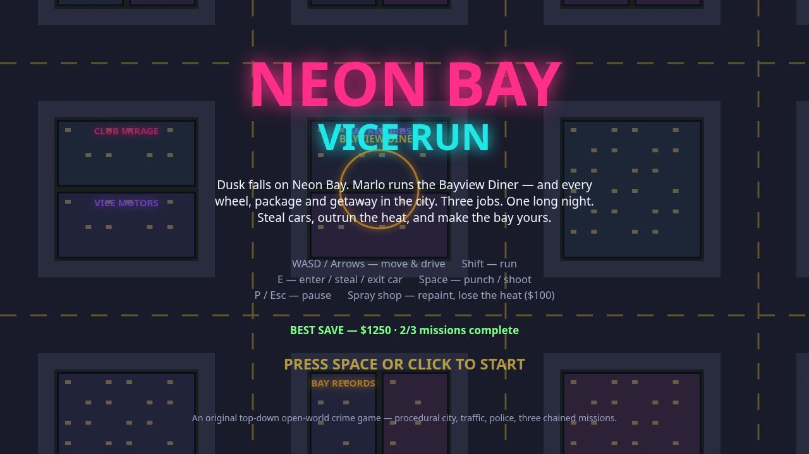
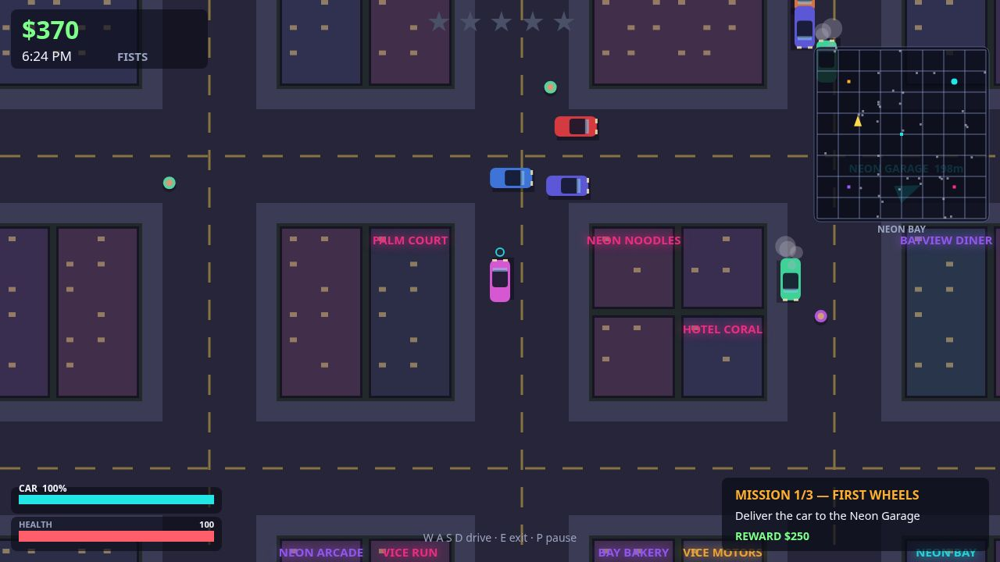
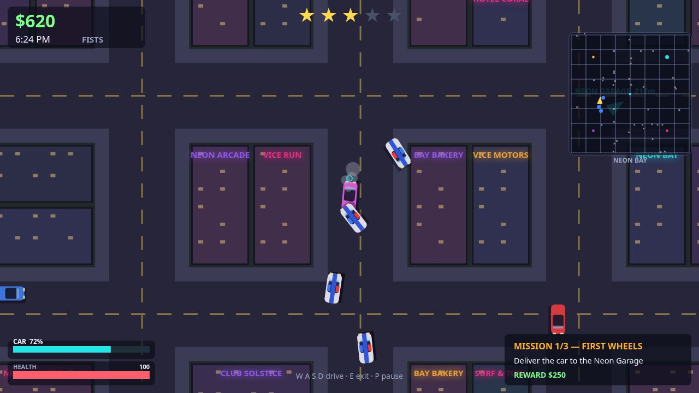
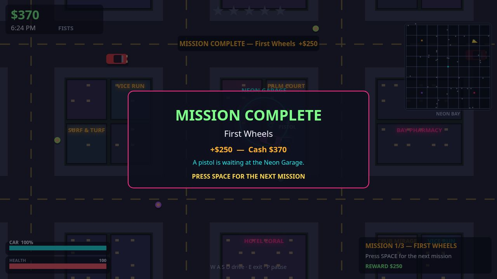

# Neon Bay: Vice Run


**Bounty:** [make.fun — gta6-01 "Make GTA 6"](https://make.fun/bounty/gta6-01)

## The story

Dusk falls on **Neon Bay**, a neon-soaked coastal city of diners, arcades and
back-street garages. Marlo, who runs the Bayview Diner, has three jobs for a
driver who doesn't ask questions: steal a car and deliver it, run a package
across town under heat, and make one last timed escape while the whole bay
lights up behind you. Three jobs. One long night. Make the bay yours.

## Screenshots









## Controls

| Keys | Action |
| --- | --- |
| WASD / Arrow keys | Walk · drive (accelerate, brake/reverse, steer) |
| Shift | Run on foot |
| E | Enter / steal a car · exit car |
| Space / Click | Punch · shoot (with the pistol) · confirm panels |
| P / Esc | Pause |
| R | Restart after busted / wasted |

## Systems

- **Procedural seeded city** — a deterministic block grid with roads, dashed
  centre lines, sidewalks, hundreds of buildings with lit windows and glowing
  neon signs (Neon Bay, Vice Run, Bayview Diner, Palm Court, Hotel Azure,
  Club Mirage, Pier 9…), plus named landmarks and a dusk palette.
- **On foot & driving** — walk and run anywhere; enter any car with E. Driving
  has acceleration, braking, reverse and speed-sensitive steering.
- **Traffic & pedestrians** — traffic cars follow the road grid and turn at
  junctions; pedestrians stroll the sidewalks, flee danger and can be run
  down (the police notice).
- **Car stealing** — press E by a driven car to pull the driver out onto the
  street. Wanted +1, every time.
- **Wanted 0–5 stars & police** — police spawn with your stars, chase and ram;
  at 3+ stars they shoot. Break line of sight to cool down, or use the
  **Vice Spray Shop**: repaint for $100 and the heat is gone.
- **Damage** — collisions dent cars; hurt cars smoke, wrecks burn. Health and
  car-health bars keep score.
- **Three chained missions** with briefing panels, an on-screen tracker and a
  waypoint arrow: **M1 "First Wheels"** (steal & deliver, $250),
  **M2 "Bayview Run"** (package run under 2-star heat, $450),
  **M3 "Vice Run"** (timed 3-star cross-city escape, $900).
- **Combat** — fists from the start; a **pistol pickup** waits at the Neon
  Garage after M1.
- **HUD & minimap** — cash, clock, wanted stars, health, mission tracker with
  reward/countdown, event banners, and a live minimap with roads, landmarks,
  traffic, police dots, waypoint and player arrow.
- **Save & screens** — title screen with story and best save, pause,
  BUSTED / WASTED game-over screens, and a localStorage save of best cash and
  missions completed.
- **Synth sound** — WebAudio engine hum that follows your speed, police
  sirens, pickup and cash blips, punches and shots. No audio files.

## Run it

```sh
node serve.ts          # serves game/ on http://localhost:8080
node main.ts           # builds /output with dossier.json (the hand-in)
```

No libraries, no network, no build step — plain ES modules in `game/`.
Deterministic scenes for screenshots: `?shot=start|play|chase|mission&seed=1`.
